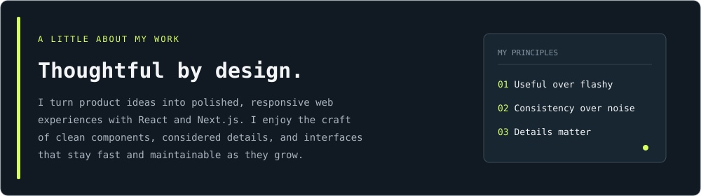

 

 

## `~/about`

 

<i>"Code is not just about making things work, it's about making them better."</i>

 

## `~/stack`

  
   

  

  
     

  

  
   

 

## `~/github-insights`

 

  

### 🐍 Contribution Snake

<picture>
  <source media="(prefers-color-scheme: dark)" srcset="https://raw.githubusercontent.com/Amirsaboor/Amirsaboor/output/github-snake-dark.svg"/>
  <source media="(prefers-color-scheme: light)" srcset="https://raw.githubusercontent.com/Amirsaboor/Amirsaboor/output/github-snake.svg"/>
  
</picture>

 

## `~/connect`

  

