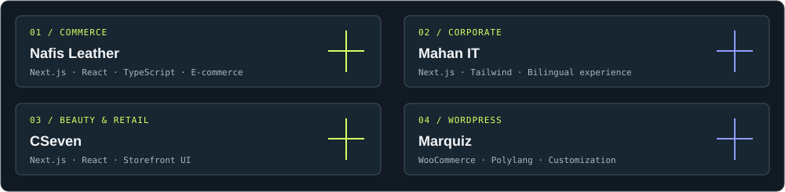

 

---

## The person behind the pixels

## My toolkit

  

## Selected work

- **Nafis Leather** — Next.js e-commerce, product experiences and API-driven shopping flows.
- **Mahan IT** — Bilingual corporate website redesign with a consistent component system.
- **CSeven** — Cosmetics storefront and product category experience.
- **Marquiz** — Multilingual WordPress and WooCommerce customization.

## GitHub activity

## Say hello

